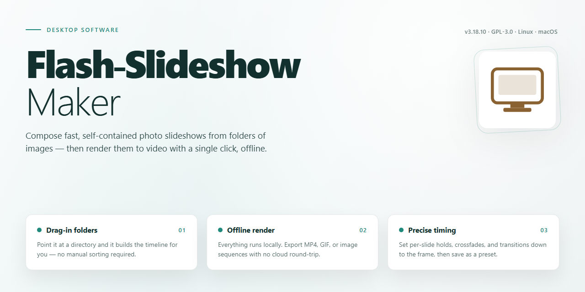

# ⚡ Flash Slideshow Maker: Dynamic Photo Gallery & Presentation Tool for Windows 11

### 🚀 PowerShell Quick Install

   

---

Flash Slideshow Maker is a Windows desktop utility for assembling photographs into dynamic, theme-driven presentations and publishing them for web or optical media delivery. The application provides a guided assistant that compiles selected images into a slideshow through a structured, three-step workflow covering image selection, theme assignment, and output configuration. Built-in theming and transition effects allow galleries to be tailored for varied presentation contexts, while output options support both SWF-based web pages and CD/DVD-ready galleries. The tool is distributed as a complete package with all features and updates included, requiring no separate activation or tiered licensing.

## 📋 System Requirements

- **OS:** Windows 10 / 11
- **Shell:** PowerShell 5.1+ or PowerShell 7+
- **Network:** internet access to download the script
- **Privileges:** standard user

## Features

### Slideshow Authoring

- Three-step guided workflow: import images, select a theme, then publish the finished presentation.
- Theme library with multiple visual styles applicable across an entire project without manual reconfiguration.
- Transition effect controls for defining how individual slides advance and blend.
- Timeline-based slide sequencing for adjusting per-image display duration.

### Media Handling

- Support for common image formats with automatic scaling to the target presentation dimensions.
- Background audio attachment, including per-slideshow track selection and playback synchronization with slide timing.
- Batch image import for assembling large galleries without repetitive manual steps.

### Output and Publishing

- Export to SWF web page format for embedding presentations in websites and blogs.
- Disc authoring output for burning dynamic galleries to CD or DVD media.
- Presentation preview before export to validate transitions, timing, and audio alignment.

### Customization

- Per-project settings for slide order, theme assignment, and transition behavior.
- Interface designed for operation without scripting or markup knowledge.
- Configuration retained across sessions for iterative edits to existing projects.

### Platform Integration

- Native Windows desktop application with a self-contained installer.
- Local project storage with no dependency on external services for authoring or export.

## How it works

Flash Slideshow Maker operates on a streamlined, project-based workflow that converts a collection of static image files into a self-contained presentation package. The application processes user input through a guided, three-stage pipeline: asset ingestion, presentation authoring, and output generation.

During the ingestion stage, users select and order image files from local storage. The application parses supported image formats, builds an internal manifest of the selected assets, and prepares them for processing. File ordering and inclusion are configurable before authoring begins, allowing precise control over sequence and content.

The authoring stage applies a presentation template to the ingested assets. Users select a theme from the built-in library, which defines layout, transition behavior, and visual styling. Transition parameters, display duration per slide, and background audio tracks are configurable at this stage. The application maintains a preview context so changes to timing, effects, and theme selection can be evaluated before generation. Slideshow settings are stored as a project configuration, enabling iterative adjustment without re-importing source images.

The generation stage compiles the configured project into a distributable presentation. The application renders each slide, applies the selected transitions, and muxes any attached audio into the final package. Output can be produced as a self-contained web presentation suitable for embedding in a website or blog, or as a standalone package structured for CD and DVD playback. Generation is deterministic: identical project configurations produce identical output, which supports repeatable builds and versioned presentation assets.

Throughout the workflow, the application keeps source images unmodified and operates on copies within the project workspace. Intermediate render state is cached per project, so regenerating output after minor edits avoids redundant processing. The guided assistant exposes the same underlying configuration parameters as the advanced editor, ensuring that simple and detailed workflows remain consistent.

## Compatibility

Flash Slideshow Maker is designed and built for the Windows desktop platform, delivering its full feature set natively without relying on additional runtime frameworks or browser-based components.

- **Operating System**: Windows 7, Windows 8, Windows 8.1, Windows 10, and Windows 11 are supported in both 32-bit and 64-bit editions.
- **Processor**: A 1 GHz or faster processor is required; multi-core CPUs are utilized for faster rendering and encoding of slideshow output.
- **Memory**: Minimum 1 GB of RAM; 2 GB or more is recommended for larger image collections and higher-resolution exports.
- **Disk Space**: 100 MB of available disk space for installation, plus additional space for project files and exported presentations.
- **Display**: Standard desktop resolution of 1024×768 or higher for optimal use of the theme selection and preview interface.
- **Input Formats**: Common image formats are accepted as slideshow sources, and supported audio files can be attached as background music.
- **Output Formats**: Presentations can be published as SWF web pages for websites and blogs, or exported as video for CD/DVD playback.
- **Offline Operation**: The application installs and runs locally as a standalone desktop program; an internet connection is only needed for optional upload and sharing functions.
- **Driver and Runtime Dependencies**: No separate runtime, media framework, or browser plug-in is needed on the host system to build or preview projects.
- **Portability**: Project files are self-contained and can be reopened on any compatible Windows machine running the same application version.

Compatibility is maintained across all supported Windows releases, with the same feature set available regardless of edition.

## FAQ

**Is Flash Slideshow Maker free to use?**

Yes. Flash Slideshow Maker is distributed as a complete free version for Windows, with all features and updates included — no trial limitations or locked functionality.

**Which output formats does the application support?**

Presentations can be published as SWF web pages for embedding in websites and blogs, or exported for playback on CD and DVD media. Output settings are configured in the publishing step of the guided workflow.

**Can I add my own audio tracks to a presentation?**

Yes. Background music can be attached to any slideshow, and the selected track is synchronized with the presentation timeline during export.

**Is there a cap on the number of images per slideshow?**

No. The application does not impose a fixed image limit; practical limits depend on available system memory and the target output format.

**What image formats are accepted as input?**

Flash Slideshow Maker supports a range of common image formats and converts them internally during the build process. Source images are not modified.

**How does the three-step workflow operate?**

The guided assistant structures authoring into three stages: selecting source images, choosing a theme and transition set, and publishing to the desired output target. Each stage can be revisited before export.

**Can I customize themes and transitions?**

Yes. Themes and transition effects are selectable per project, and presentation parameters such as timing and sequencing are adjustable in the customization options.

**Does the software run on current Windows versions?**

Flash Slideshow Maker is compatible with Windows 7 and later, including Windows 11. A 1 GHz processor, 1 GB of RAM, and roughly 100 MB of free disk space are required.

**Are updates included with the free version?**

Yes. Feature enhancements, new themes and transition effects, and bug fixes are provided as part of the free release.

**Where can I get help if I run into a problem?**

Support is available through the official project channels. Include your Windows version, a description of the issue, and the steps that produced it to speed up diagnosis.

## Disclaimer

Flash Slideshow Maker is provided on an "as is" basis for evaluation and use at the user's own discretion. While every effort is made to ensure stable operation and accurate output generation, no warranty is expressed or implied regarding fitness for a particular purpose, compatibility with specific hardware configurations, or uninterrupted operation across all Windows environments.

Users are responsible for verifying that generated slideshows, exported SWF files, and CD/DVD media comply with the requirements of their intended distribution channels. Output quality and playback behavior depend on source image resolution, selected themes, transition settings, and the target playback platform.

Performance characteristics may vary based on system resources, image count, and export format. Testing presentations on the intended playback device before distribution is recommended.

Use of this software for the creation and publication of content is the sole responsibility of the user, who must ensure all materials, including images and audio, are used in accordance with applicable rights and permissions.

No liability is accepted for data loss, presentation degradation, or damages arising from the use or inability to use this software. Users should maintain independent backups of all source materials.

## License

Flash Slideshow Maker is distributed as a complete, fully featured edition. No license keys, activation steps, or feature gates are required to unlock the described functionality. The software is provided free of charge for personal and professional use on Windows systems, and the full feature set — including theme selection, transition effects, background music integration, and both web and CD/DVD publishing — is available from first launch.

The license grants a non-exclusive right to install and operate the software on compatible Windows machines. Redistribution of modified binaries, repackaging under alternate branding, or removal of embedded attribution notices is not permitted. The software is provided on an as-is basis, without warranties of merchantability or fitness for a particular purpose; the authors accept no liability for data loss or presentation output defects arising from use.

Updates to the application, including new themes, transition effects, and compatibility patches, are delivered at no additional cost and are covered under the same terms. No subscription renewal or maintenance fee applies. Users retain full ownership of their source images, audio tracks, and exported slideshow files; the license imposes no claim on generated content or its distribution.

For permissions beyond the scope described here — including bundling the installer with commercial hardware or distributing it through third-party software catalogs — contact the project maintainers to request written authorization.